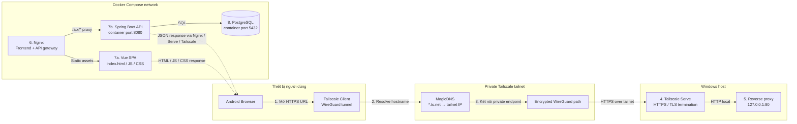

# Network flow — truy cập ứng dụng qua Tailscale

Tài liệu này mô tả đường đi của request từ lúc người dùng mở URL Tailscale trên điện thoại đến khi giao diện Personal Finance Planner được tải và dữ liệu API được trả về.

## Endpoint đang sử dụng

```text
https://desktop-3ta52l8.tail881468.ts.net
```

Query string như `utm_source=chatgpt.com` không phải một phần của endpoint và không cần thiết để truy cập ứng dụng.

## Sơ đồ network flow

Nguồn diagram có thể chỉnh sửa: [`diagrams/tailscale-network-flow.mmd`](diagrams/tailscale-network-flow.mmd).



## Trình tự xử lý

1. Người dùng bật Tailscale trên điện thoại và mở hostname HTTPS. Phần `utm_source` nếu có chỉ là query tracking, không tham gia định tuyến.
2. MagicDNS phân giải hostname `*.ts.net` thành địa chỉ tailnet của Windows host.
3. Tailscale thiết lập đường truyền riêng được mã hóa bằng WireGuard giữa thiết bị và host. Chỉ thiết bị/người dùng được phép trong tailnet mới truy cập được endpoint private này.
4. Tailscale Serve trên Windows host nhận kết nối HTTPS và xử lý TLS cho hostname Tailscale.
5. Serve reverse-proxy request đến `http://127.0.0.1:80` trên Windows host.
6. Docker Nginx nhận request. Nginx phục vụ frontend build hoặc chuyển tiếp request API theo prefix `/api/` đến Spring Boot.
7. Với request giao diện, Nginx trả `index.html`, JavaScript và CSS để browser khởi chạy Vue SPA. Với request API, Nginx proxy đến backend Spring Boot trên Docker network.
8. Spring Boot truy cập PostgreSQL qua Docker internal network khi nghiệp vụ cần đọc/ghi dữ liệu. JSON response quay ngược qua Nginx, Tailscale Serve và tunnel Tailscale về browser.

## Ranh giới mạng và bảo mật

| Thành phần | Phạm vi truy cập | Ghi chú |
|---|---|---|
| Tailscale Serve HTTPS | Private tailnet | Không bật Funnel; không phải website public |
| Nginx `127.0.0.1:80` | Windows loopback | Chỉ Serve trên host forward vào cổng này |
| Spring Boot `8080` | Docker internal network | Không publish trực tiếp ra host/Internet |
| PostgreSQL `5432` | Docker internal network | Không publish trực tiếp ra host/Internet |

Tailscale kiểm soát lớp truy cập mạng, không thay thế authentication/authorization của ứng dụng. Vì ứng dụng hiện chưa có đăng nhập người dùng riêng, chỉ cho thiết bị cá nhân đáng tin cậy tham gia tailnet.

## Điều kiện để truy cập thành công

- Windows host đang bật, có Internet và Tailscale đang kết nối.
- Docker engine và các container ứng dụng đang chạy.
- Tailscale Serve vẫn cấu hình proxy tới `http://127.0.0.1:80`.
- Điện thoại/laptop đã đăng nhập cùng tailnet và đang bật Tailscale.

Chi tiết cài đặt, vận hành và troubleshooting: [11 — Remote access with Tailscale](11-remote-access-tailscale.md).
